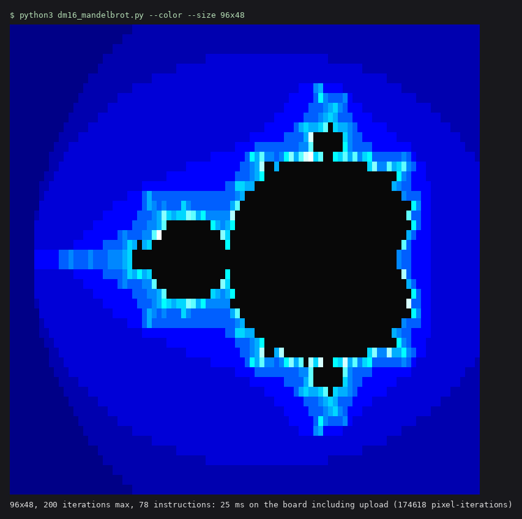
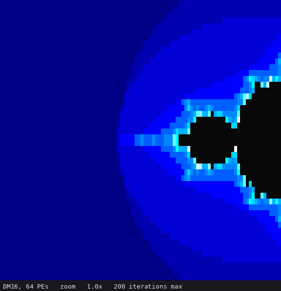
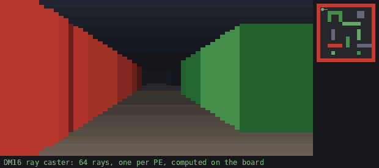
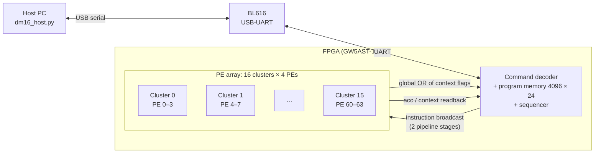
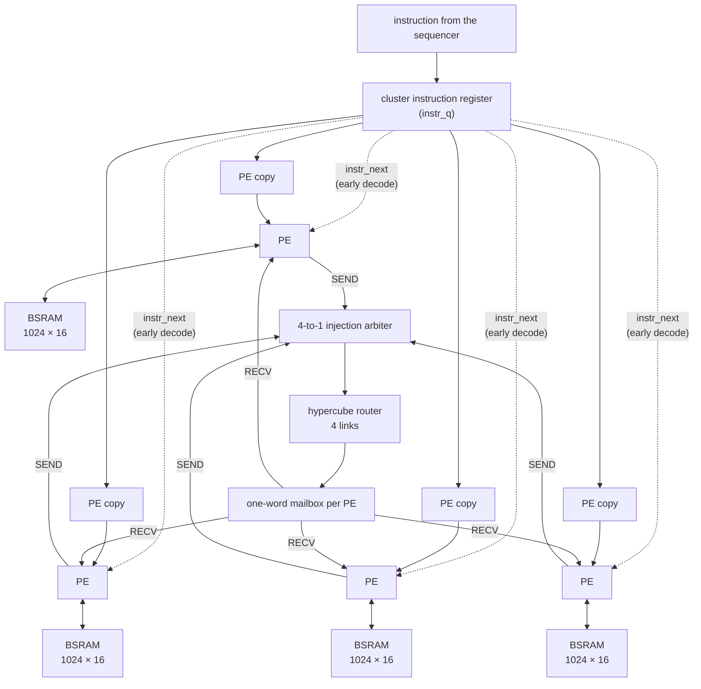
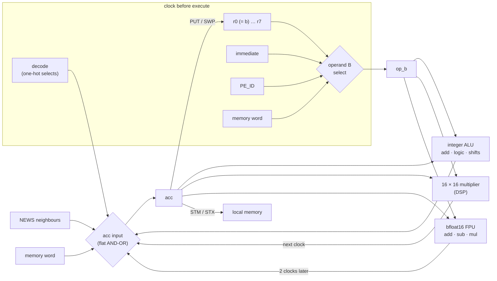

# DM16 (Dinky Machine 16)

DM16 is a small massively parallel computer in the style of the Thinking
Machines **Connection Machine**, built in an FPGA. A single sequencer
broadcasts each instruction to **64 processing elements (PEs)**, which all
execute it at the same time on their own data (SIMD). Each PE has a 16-bit
integer ALU, a **bfloat16 floating-point unit**, eight registers, and 2 KB of
private memory. The PEs talk to each other over two networks: a nearest-neighbour
**NEWS grid** and a **4-D hypercube** packet router. A host PC loads programs
and data over USB serial and reads the results back.

It runs on the Sipeed **Tang Console 138K** (Gowin GW5AST-138) at 50 MHz, and
in smaller versions on the budget **Tang Nano 20K** and **Tang Nano 9K** (see
[Boards](#boards)).



*The Mandelbrot set from `dm16_mandelbrot.py --color`: 64 pixels at a time,
one per PE, looping with `BANY` until every PE's point has escaped. The whole
96 × 48 image is one program run of about a hundred instructions and takes
25 ms on the board.*



*`dm16_mandelbrot.py --zoom`: 63× into the antenna on the left of the set,
where a complete miniature copy (a "minibrot") appears. Every frame was
computed on the board, at about 7 frames a second including the readback; the
GIF plays it at a steady speed. The zoom stops here because the PEs use 16-bit
fixed point: any deeper and neighbouring pixels would be less than two steps
of 1/4096 apart.*

| | |
|---|---|
| PEs | 64: 16 clusters × 4 PEs |
| Datapath | 16-bit; every value is an int16 or a bfloat16 |
| Per PE | `acc`, `r0`–`r7` (`r0` is `b`), 10-bit `mar`, C/Z/N flags, 4-deep context stack, 1024 × 16-bit memory |
| Arithmetic | add/sub/logic, 16 × 16 multiply (low and high halves), barrel shifts, rotates and funnel shifts; bf16 add/sub/mul/compare/convert |
| Networks | NEWS: 8 × 8 torus, 1 clock per hop. Hypercube: 4 dimensions between clusters, e-cube routing |
| Sequencer | 4096-instruction program memory, nested hardware loops, jumps, branches on a global OR of all PEs |
| Host link | UART over the board's USB port, 115200 baud at reset, 2 Mbaud in normal use; the USB bridge adds ~6 ms per request and forwards ~80 KB/s to the PC |
| Clock | 50 MHz from the on-chip PLL |
| Peak rate | 25 M instructions/s × 64 PEs = 1.6 G 16-bit operations/s |

## What is it good for?

### Does it run DOOM?

No. DOOM needs a general-purpose CPU: one fast thread of branchy,
pointer-chasing code, several megabytes of memory for the game data, and a
screen. DM16 is the opposite kind of machine. It has 64 small PEs that all run
the *same* instruction, 128 KB of memory in total (2 KB per PE), room for 4096
instructions, and no video output. Its only link to the outside world is a
USB serial port that carries about 80 KB/s back to the PC, so it couldn't even
get DOOM's frames out fast enough: a 320 × 200 frame is 64 KB, and DOOM wants
35 of them a second, over 2 MB/s.

What it *can* do is the part of a 3-D renderer that is genuinely parallel. In
a Wolfenstein-style ray caster each screen column needs its own ray traced
through the map, and `dm16_raycast.py` gives each PE one column: 64 rays at
once, marching through a 16 × 16 map in every PE's memory and looping with
`BANY` until every ray has hit a wall. It runs at about 40 frames a second,
and you can walk around in it with the keyboard.



*`dm16_raycast.py --demo`: every column of every frame is computed on the
board (about 20 ms per frame) and checked against a Python model; the PC only
draws the result. A real DOOM is still out of reach, but this is the core
idea of Wolfenstein 3D, running SIMD.*

### What it is good at

DM16 shines when the same small calculation has to be done on lots of pieces
of data at once, especially when each piece only needs to talk to its
neighbours:

* **Cellular automata and grid simulations:** Game of Life (included),
  heat diffusion, wave equations, sandpiles, lattice-gas fluids. Each PE owns
  a cell or a small tile and swaps edges with its neighbours over the NEWS
  grid in one instruction.
* **Image processing on small tiles:** blurs, edge detection, thresholding,
  morphology, one pixel or tile per PE.
* **Parallel algorithms on the hypercube:** prefix sums (included),
  reductions, bitonic sort, FFT butterflies, matrix transposes. These are the
  textbook Connection Machine algorithms, and the "cube swap" `SEND` does
  their communication step in one instruction.
* **Monte Carlo simulations:** each PE runs its own random-number generator
  (xorshift is three shift/XOR pairs with the barrel shifter) and its own
  trials; the host adds up the results.
* **Small neural networks and signal processing:** bfloat16 multiply-add,
  dot products with the running sum in a register, and Q8.8 fixed point for
  filters.
* **Data-dependent loops:** the global OR lets a program iterate until every
  PE has finished, as in escape-time fractals (the Mandelbrot demo, included),
  root finding or iterative solvers.

### What it is not good at

* **Raw speed.** Its peak of 1.6 G 16-bit operations a second is far below a
  modern laptop CPU, let alone a GPU. DM16 is interesting for *how* it
  computes, not how fast.
* **Different work on different PEs.** Every PE runs the same instruction.
  PEs whose condition is false sit idle, so heavily branching code wastes most
  of the machine.
* **Big data sets.** 2 KB per PE, and the serial link limits how fast data
  can come in and go out.

### Practical uses

* **Learning parallel computing.** It is a real, working SIMD machine small
  enough to understand completely, from the instruction set down to the
  Verilog. Masked execution, global reductions, nearest-neighbour and
  hypercube communication are all here in a few thousand lines.
* **Exploring computer history.** It works much like the Connection Machine
  CM-1/CM-2 of the 1980s, a 64-PE miniature of a 65,536-processor
  supercomputer, so classic papers and algorithms can be tried out for real.
* **Prototyping SIMD algorithms and hardware ideas.** New instructions,
  networks or memory layouts can be added and measured on real hardware;
  the register file and barrel shifter were added this way.
* **A building block in a bigger FPGA design.** Fed directly from a camera,
  ADC or sensor interface in the same FPGA, instead of the slow serial link,
  the array could filter or analyse data in real time.

### A chat model that runs on the board

`dm16_chat.py` is a tiny character-level chatbot whose whole reply is
generated on the Tang Console. It builds on
[Z80-μLM](https://github.com/HarryR/z80ai) by HarryR, a chat model made for a
4 MHz Z80: it uses the same input encoding (the query's trigrams and the last
8 reply characters' n-grams, hashed into 256 buckets) and was trained on that
project's tinychat data. The network is new and designed for DM16: 256 → 256
→ 128 → 40 with 4-bit weights, so each weight is one `MUL` and `ADD`, and its
integer arithmetic is exactly what the PEs compute.

For each character, every PE hashes the context itself, works out its own
neurons of each layer, and shares them through an all-gather over the
hypercube; two more hypercube passes find the highest-scoring character.
The PC sends the query and reads back the finished reply: one request per
reply.

| | Z80-μLM's model (2-bit, on a Z80) | DM16 chat model (4-bit) |
|---|---|---|
| Replies exactly right, tinychat queries it was trained on | 39.0% | **99.7%** |
| Replies exactly right, queries held out of training | — | 26.6% |
| Speed | 1–2 s per character at 4 MHz | ~150 characters/s (~30 ms per reply) |

It mostly recalls the replies it learned: with about 2,300 queries to learn
from, it answers unseen queries less reliably. On the board it reproduces the
integer model exactly: all 2,290 training queries gave identical replies, and
`--check` compares every output value, character by character.

```sh
python3 dm16_chat.py                       # chat; uses models/tinychat_int4.npz
> hello
HI   (30 ms)

# retrain (about 6 minutes, NumPy only); the data comes from the z80ai repo
python3 dm16_chat_train.py --data ~/z80ai/examples/tinychat/training-data.txt.gz \
                           --out models/tinychat_int4.npz
```

## How it works

### The big picture



1. The host writes a program into the sequencer's program memory and starts
   it, or injects single instructions directly.
2. The sequencer fetches one instruction at a time. Control instructions
   (loops, jumps, branches, `HALT`) are executed by the sequencer itself.
   Everything else is broadcast to all 64 PEs.
3. Every PE executes the broadcast instruction on its own registers and
   memory, unless its **context flag** is off, in which case it ignores the
   instruction. This is how a SIMD machine does `if`: the PEs evaluate a
   condition, the ones where it is false switch themselves off, and the rest
   carry on.
4. The sequencer can test whether **any** PE is still active (a global OR of
   all 64 context flags). That lets a program loop until every PE is done,
   for example in an escape-time fractal or an iterative solver.
5. The host reads results back as each PE's `acc`, or a memory word from every
   PE at once.

### Inside a cluster

Each cluster holds four PEs, their memories, and the network hardware they
share.



The instruction passes through two register stages on its way to a PE: one
per cluster, then one per PE. Each register only drives logic close to it,
which keeps the 64-way broadcast from limiting the clock speed. Every PE sees
the same instruction on the same clock.

### The processing element



It is an **accumulator machine**: almost every operation is
`acc = acc OP operand`. The operand comes from a register, an immediate, the
PE's own ID, or local memory.

### Instruction timing

The sequencer issues at most one instruction every two clocks, and the PE
design relies on that idle clock:

```
clock          1          2          3          4
             ┌──────────┬──────────┬──────────┬──────────┐
instr_next   │  ADD r3  │          │   MUL    │          │
instr        │          │  ADD r3  │  (idle)  │   MUL    │ …
PE work      │ decode,  │ execute: │ set Z/N  │ execute  │
             │ read r3  │ acc +=   │ from acc │          │
             │ → op_b   │ op_b     │          │          │
             └──────────┴──────────┴──────────┴──────────┘
```

* **Before execute:** the PE decodes the next instruction (it is visible one
  clock early on `instr_next`) and loads operand B into a register.
* **Execute:** `acc` is updated from a flat AND-OR of all possible results,
  selected by the pre-decoded one-hot signals.
* **Idle clock:** `MUL`/`MULH` write their registered product to `acc`, and
  ALU ops set the Z and N flags from the new `acc`.

So most instructions take **2 clocks**. Instructions that read memory take 4,
because the block RAM read needs two extra clocks. `FADD`, `FSUB`, `FMUL` and
`FI2F` take one extra clock, because the FPU result arrives two clocks after
execute.

### Networks

**NEWS grid.** The 64 PEs form an 8 × 8 torus: PE `i` sits at row `i / 8`,
column `i % 8`, and the edges wrap round. `NEWS N` (or E, W, S) copies the
neighbour's `acc` into this PE's `acc`, on every PE at once, in one
instruction. It suits image filters, cellular automata and stencils;
`dm16_life.py` runs Conway's Game of Life with one cell per PE.

```
        col 0   1   2   3   4   5   6   7
row 0      0   1   2   3   4   5   6   7     N
row 1      8   9  10  11  12  13  14  15   W ✛ E
 …                                           S
row 7     56  57  58  59  60  61  62  63    (edges wrap round)
```

**Hypercube router.** The 16 clusters are the corners of a 4-dimensional
hypercube: two clusters are linked when their numbers differ in exactly one
bit, so any packet needs at most 4 hops. Each link is 4 bits wide, and a
24-bit packet crosses it in 6 beats. Routing is dimension-ordered ("e-cube"),
which cannot deadlock. A PE sends `b` to any other PE with `SEND`. The
destination can be fixed, taken from `acc`, or `PE_ID XOR mask` (the classic
"cube swap" used by parallel prefix sums and FFTs). `RECV` takes the word
from the PE's one-word mailbox and sets C if one was waiting.

```
PE_ID (6 bits):   [ cluster: 4 bits | lane: 2 bits ]
                     hypercube corner   PE within the cluster
```

## Instruction set

Instructions are 24 bits wide:

```
 23    20 19    16 15  14 13      10 9                   0
┌────────┬────────┬──────┬──────────┬─────────────────────┐
│ opcode │ sub_op │ src  │ flag_ctl │        imm10        │
└────────┴────────┴──────┴──────────┴─────────────────────┘
```

**Operand B** (`src`, for ALU and FPU ops): `0` register `r[imm & 7]`
(`r0` is `b`) · `1` sign-extended `imm10` · `2` `PE_ID` · `3` memory word.

**Memory address** (any instruction that touches memory): `imm10`, or `mar`
when `flag_ctl` bit 0 is set. `flag_ctl` bit 1 post-increments `mar`.
`LDX`/`STX` always use `mar`.

| Op | Name | Effect |
|---|---|---|
| 0 | `NOP` | |
| 1 | `LDI` | sub 0: `acc = sext(imm10)`; 1: `acc[15:8] = imm8`; 2: `acc[7:0] = imm8` |
| 2 / 3 | `LDM` / `STM` | `acc = mem[addr]` / `mem[addr] = acc` |
| 4 / 5 | `LDX` / `STX` | `acc = mem[mar]` / `mem[mar] = acc` |
| 6 | `MAR` | `mar = acc` (src 0) or `imm10` |
| 7 | `ALU` | `acc = acc OP operand`, see below |
| 8 | `SWP` | sub 0: `acc ↔ r[n]`; 1 `PUT`: `r[n] = acc`; 2 `GET`: `acc = r[n]` |
| 9 | `CTX` | set, push, pop or invert the context flag (see below) |
| A | `SEND` | send `b` to PE `imm`, `acc`, or `PE_ID ^ imm` |
| B | `RECV` | `b = mailbox`; C = 1 if a word was waiting |
| C | `NEWS` | `acc` = neighbour's `acc` (sub 0 N, 1 E, 2 W, 3 S) |
| D | `FPU` | bfloat16 ops, see below |
| F | — | sequencer control, never sent to the PEs |

**ALU** (`sub_op`): `0 ADD`, `1 ADC`, `2 SUB` (C = borrow), `3 AND`, `4 OR`,
`5 XOR`, `6 SHL`, `7 SHR`, `8 MOV`, `9 ASR` (single-bit shifts), `A MUL`
(low 16 bits), `B MULH` (high 16 bits, signed), `C SHLN`, `D SHRN`, `E ASRN`
(shift by `operand & 15`), `F ROL`. Bit 2 of `flag_ctl` (`x=True` in the
host library) selects a variant: `MULH` unsigned, `ROL` becomes `ROR`, and
`SHLN`/`SHRN` become funnel shifts that pull bits in from `b`. A Q8.8
fixed-point multiply is three instructions: `MUL`, `MULH`, then a funnel
`SHRN` by 8.

**FPU** (`sub_op`): `0 FADD`, `1 FSUB`, `2 FMUL`, `3 FCMP` (Z equal, N less,
C unordered), `4 FI2F` (int16 to bf16), `5 FF2I` (bf16 to int16, truncating
and saturating), `6 FNEG`, `7 FABS`. Subnormals are flushed to zero.

**Context** (`CTX`, `sub_op` is the condition): always, never, Z, not Z, C,
N, or `PE_ID == imm`. `flag_ctl` picks the action: set the flag, push it (for
nested `if`s), pop, or invert (for `else`).

**Sequencer control** (opcode F): `LOOP n` … `ENDL` (nested 4 deep, up to
65535 iterations), `JMP`, `BANY` / `BNONE` (branch if any / no PE is active),
`HALT`.

## Programming it

Programs are written in Python with the helpers in `dm16_host.py`:

```python
from dm16_host import *

with open_dm16() as ser:                      # opens the UART at 2 Mbaud
    upload_and_run(ser, [
        ctx(CTX_ALWAYS),                      # every PE active
        alu(ALU_MOV, SRC_ID),                 # acc = PE_ID
        put(1),                               # r1 = PE_ID
        LOOP(10),
            alu(ALU_ADD, SRC_R, 1),           # acc += r1
        ENDL,
        stm(0x100),                           # mem[0x100] = 11 * PE_ID
    ])
    print(read_mem_grid(ser, 0x100))          # one value per PE
```

`upload_and_run` resolves labels, writes the program, starts it, and waits for
the sequencer to finish. `inject_instr` runs a single instruction straight
away. `read_acc_grid`, `read_mem_grid`, `read_mem_block` and `write_words` move data
in and out. Each request costs a fixed ~6 ms USB round trip, so
`read_mem_block`, which fetches many words in one request, is much faster
than a loop of `read_mem_grid` calls.

### Host protocol

The host library hides this, but the UART commands are:

| Command | Bytes | Action |
|---|---|---|
| `01` | `a_hi a_lo i2 i1 i0` | write program word `a` |
| `02` | `e_hi e_lo` | run from 0 until `pc == e` or `HALT` |
| `03` | | single step |
| `04` | | halt, `pc = 0` |
| `05` | | read the context mask (one bit per PE: 8 bytes on the Console, 1 on a Nano) |
| `06` | `i2 i1 i0` | execute one instruction now |
| `07` | | read every PE's `acc` (2 bytes per PE) |
| `08` | `d_hi d_lo` | set the UART clocks per bit (baud rate) |
| `09` | | read status: bit 0 running, bit 1 any PE active |
| `0B` | | read the configuration: 12 bytes (`'D'`, format, width, dimensions, lanes, columns, log₂ registers, log₂ memory words, flags, clock in kHz) |
| `0A` | `a_hi a_lo n_hi n_lo` | read `n` words from address `a` of every PE (`n` × 2 bytes per PE; above the first 1,024 words it goes through `mar`) |

## Boards

| | Tang Console 138K | Tang Nano 20K | Tang Nano 9K |
|---|---|---|---|
| FPGA | Gowin GW5AST-138 | Gowin GW2AR-18 | Gowin GW1NR-9 |
| PEs | 64 (16 clusters × 4) | 8 (4 clusters × 2) | 8 (4 clusters × 2) |
| Hypercube / NEWS torus | 4-D / 8 × 8 | 2-D / 4 × 2 | 2-D / 4 × 2 |
| bf16 FPU | yes | yes | **no**: FPU instructions are no-ops |
| Clock (Fmax) | 50 MHz (58.3) | 27 MHz (54.2) | 27 MHz (48.9) |
| Logic used | 72% | 58% | 82% |
| Host link | 2 Mbaud | 1 Mbaud | 1 Mbaud, from reset |
| `DM16_BOARD` | `console138k` (default) | `nano20k` | `nano9k` |
| Mandelbrot 80 × 40 | 24 ms | 104 ms | 94 ms |
| Ray caster | ~40 frames/s | ~30 frames/s | ~45 frames/s |

All three have 16-bit PEs with 8 registers and 1,024 words of memory each, run
the same instruction set and pass the same tests (the 9K skips the
floating-point ones). The Nano builds trade PEs for price: 8 PEs is enough to
learn and try every part of the machine, and the ray caster still draws its 64
columns, each PE tracing 8 of them in turn. (The 9K's frames come out a
little faster than the 20K's: the same PEs and clock, but its USB bridge
answers each request more quickly.)

**Tang Nano 9K notes:**

* **No reset button.** S1 is on pin 4, a dual-purpose configuration pin
  (`JTAGSEL_N`) that doesn't work as an ordinary input, so the 9K build resets
  itself at power-up. To reset it, reload the bitstream or power-cycle it.
* **Its USB bridge (a BL702) doesn't handle changing baud rate while running**,
  so the 9K build starts at 1 Mbaud and the host never switches rate. The host
  also reopens the port once if the first connection after loading the FPGA
  fails, which this bridge does.
* **If a bitstream loads "successfully" but nothing runs** (LEDs off, no
  serial replies), check the configuration status with
  `openFPGALoader -b tangnano9k -v -m ...`. A 9K whose internal flash held a
  broken image showed *CRC Error* and *Non-JTAG configuration is active*
  before every load, and nothing loaded into SRAM ever started. Writing any
  valid bitstream to its flash (`openFPGALoader -b tangnano9k -f ...`) fixed
  it.

## Building and running

**Requirements:** the Gowin EDA (V1.9.12.04 here, with a license),
`openFPGALoader`, Python 3 with `pyserial`, and one of the boards above.

```sh
./build.sh                    # Tang Console: ~20 min -> impl/pnr/DM16.fs, build.log
./build.sh nano20k            # Tang Nano 20K: ~3 min -> build/nano20k/impl/pnr/DM16.fs
./build.sh nano9k             # Tang Nano 9K: ~1 min  -> build/nano9k/impl/pnr/DM16.fs

openFPGALoader -b tangconsole -m impl/pnr/DM16.fs               # load into SRAM
openFPGALoader -b tangnano20k -m build/nano20k/impl/pnr/DM16.fs
openFPGALoader -b tangnano9k  -m build/nano9k/impl/pnr/DM16.fs  # (-f writes flash instead)

DM16_BOARD=nano20k python3 dm16_loader.py    # memory, ALU, NEWS and network self-test
```

`build.sh` sets the environment the Gowin command-line tool needs on Linux,
timestamps every line of the build log, and retries if the license server
doesn't answer.

The host scripts pick the board's shape from `DM16_BOARD`, and every
connection reads the configuration the bitstream reports (command `0x0B`) and
stops with a clear message if it doesn't match: a Nano 20K run with the
Console profile is told to use `DM16_BOARD=nano20k`. The serial port is found
automatically when one board is plugged in; with several, set `DM16_PORT`,
and load each with `openFPGALoader --ftdi-serial <serial>` (`openFPGALoader
--scan-usb` lists them). The rules in `udev/` give the Tang Console's UART a
stable name, `/dev/tang_console_uart`. `DM16_BAUD` picks another rate (up to
2 Mbaud, the bridges' reliable limit).

### Tests and demos

| Script | What it does |
|---|---|
| `dm16_loader.py` | memory, ALU, NEWS and hypercube network self-test |
| `dm16_seq_test.py` | loops, nested loops, jumps, `HALT`, `BANY`/`BNONE` |
| `dm16_fp_test.py` | bfloat16 ops checked bit-for-bit against `dm16_bf16_ref.py` |
| `dm16_shift_test.py` | barrel shifts, rotates, funnel shifts, `MULH`, Q8.8 multiply |
| `dm16_regfile_test.py` | registers, register operands, masked writes, bf16 dot product |
| `dm16_prefix_sum.py` | parallel prefix sum across the hypercube |
| `dm16_stress.py` | repeated runs to catch rare glitches |
| `dm16_life.py` | Conway's Game of Life on the 8 × 8 torus |
| `dm16_raycast.py` | Wolfenstein-style ray caster, one ray per PE: W/S or arrows to move, A/D to turn; `--demo` for an autopilot tour, `--ascii` for text shading, `--check` to compare every column with a Python model |
| `dm16_chat.py` | a 4-bit chat model that generates whole replies on the Tang Console (builds on [Z80-μLM](https://github.com/HarryR/z80ai)); `--check` compares every output value with the integer model, `--test-file` compares whole replies |
| `dm16_chat_train.py` | trains that model with NumPy (quantization-aware); `--holdout` measures replies to unseen queries |
| `dm16_mandelbrot.py` | the Mandelbrot set in Q4.12 fixed point, looping with `BANY`; `--color` for colour, `--zoom` (and `--loop`) to animate a zoom into a miniature copy of the set, `--check` to compare every pixel with a Python model |

## Source files

| File | Contents |
|---|---|
| `src/dm16_top.v` | Tang Console top: PLL, reset, UART pins, LEDs, machine parameters |
| `src/boards/` | Tang Nano 20K and 9K tops, pin constraints and clock constraint |
| `src/dm16_core.v` | sequencer, clusters, NEWS wiring, routers, global OR |
| `src/dm16_uart_seq.v` | UART, host commands, program memory, sequencer |
| `src/dm16_cluster.v` | 4 PEs, their memories, network arbiter and mailboxes |
| `src/dm16_pe.v` | the processing element |
| `src/dm16_bf16.v` | pipelined bfloat16 add/sub/mul and int-to-float |
| `src/hypercube_router.v` | e-cube packet router |
| `src/dm16_pll.v`, `src/pll_init.v` | PLL and its start-up |
| `src/dm16.cst`, `src/dm16.sdc` | pin and timing constraints |
| `dm16_host.py` | host library: encoding, assembler, UART helpers |
| `dm16_model.py` | reference model of one PE at any width, used to check the RTL in simulation |
| `models/tinychat_int4.npz` | the trained chat model (54 KB), trained on Z80-μLM's tinychat data |

## Scaling it up

The PE width (`W`), registers per PE (`NREGS`, in flip-flops or block RAM),
memory per PE (`MEM_AW`), the hypercube size (`DIMS`), PEs per cluster
(`LANES`) and the torus width (`COLS`) are parameters; the Tang build uses
16 bits, 8 registers and 1,024 words. [docs/SCALING.md](docs/SCALING.md)
covers what each costs (with measured sizes), their caveats (for example,
immediate addresses reach only the first 1,024 words), what fits on which
FPGA, what must change beyond 64 PEs, and how several boards could be joined
into one machine.

## Resource use

On the GW5AST-138:

| Resource | Used |
|---|---|
| Logic (LUTs + ALUs) | 99,475 / 138,240 (72%) |
| Logic slices (CLS) | 59,521 / 69,120 (87%) |
| Flip-flops | 31,952 / 139,095 (23%) |
| Block RAM | 70 / 340 (21%): 64 PE memories + program memory |
| DSP | 96 / 298 (33%) |
| Fmax | 58.3 MHz, run at 50 MHz (the slowest path is inside the hypercube router) |

## Credits

* The chat model (`dm16_chat.py`, `dm16_chat_train.py`, `models/`) builds on
  [Z80-μLM](https://github.com/HarryR/z80ai) by HarryR: its input encoding,
  character-by-character design and tinychat training data come from that
  project.

## Known issues

* **A rare wrong result on the Tang Console, not yet explained.** Twice, in
  long runs of `dm16_mandelbrot.py --check`, a few pixels (4 in one image, 3
  across two zoom frames) came back with a lower iteration count than the
  model's; the ones traced came from PEs 60 and 61, in the same cluster. About
  1,700 checked frames and several thousand other checks since then have all
  been correct, including on a later build with more timing margin (Fmax 54.7
  → 58.3 MHz, from buffering the network injection), so the cause (a marginal
  path in that build's placement, or corruption on the USB link) is unknown. Run with `--check` if you need
  certainty, and please report a reproducible case.
